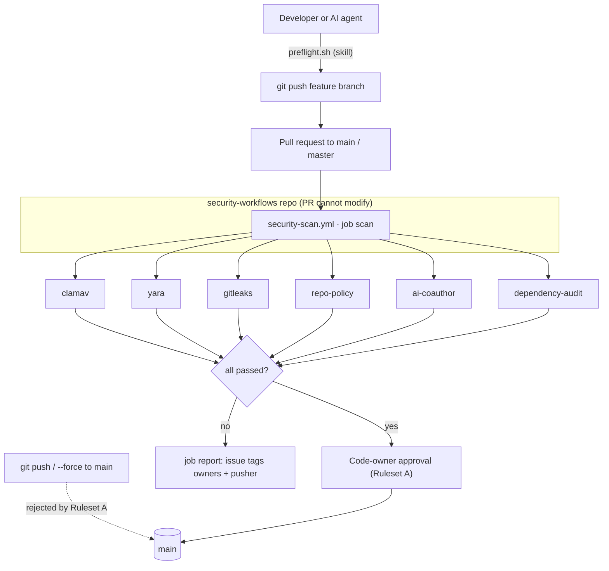

<div align="center">

  <picture>
    <source media="(prefers-color-scheme: dark)" srcset="docs/assets/logo-dark.svg">
    
  </picture>

  <h1>gh-org-guard</h1>

  <p><strong>GitHub org rulesets, a required security scan and an AI-agent PR skill, built from real attacks on dev teams: fake fonts, auto-run VS Code tasks and poisoned configs.</strong></p>

  
  
  

  <br/>

  
  
  
  
  
  

  <p>
    <a href="docs/SETUP.md">Setup guide</a> &middot;
    <a href="docs/CHECKS.md">What it blocks</a> &middot;
    <a href="docs/TESTING.md">Test evidence</a> &middot;
    <a href="docs/AGENT-SKILL.md">Agent skill</a> &middot;
    <a href="https://github.com/yousuf-git/gh-org-guard/issues">Report a bug</a>
  </p>

</div>

---

> gh-org-guard is a ready-to-apply GitHub organization setup. It has two org rulesets, one required security-scan workflow, and an AI-agent skill. Every change to `main`/`master` goes through a reviewed pull request, and that PR must pass a malware and supply-chain scan that the PR itself cannot disable. It was built after real incidents: JavaScript disguised as font files, VS Code tasks that auto-ran on folder open, and payloads appended to `tailwind.config.js` behind hundreds of spaces.

##  About

Branch protection alone stops direct pushes, but it doesn't look at what a PR contains. Scanners committed inside each repo can be switched off by the very PR they are meant to check. gh-org-guard closes both gaps:

- **Ruleset A** (`protect-main-master`) makes `main`, `master` and the default branch PR-only for every repo in the org. A PR needs a code-owner approval from someone other than the last pusher. Force-pushes and deletions are blocked.
- **Ruleset B** (`require-security-scan`) uses GitHub's *Require workflows to pass* rule. It runs one central workflow, `security-scan.yml`, from a repo the PR cannot touch, and blocks the merge until it passes. Nobody can bypass it, org owners included.
- **The scan** runs six checks in one job. It needs no paid add-ons and works on the **GitHub Team** plan.
- **The `create-pr-guarded` agent skill** teaches Claude Code, Cursor and Codex the same rules. It runs the identical checks locally before a push, and says what to do when a check fails, including when to stop and treat a finding as a security incident.

It targets JavaScript/TypeScript organizations (MERN, Next.js, Vite and similar). The file, config and malware checks apply to any stack. The dependency checks cover npm, Yarn v1, Yarn Berry and pnpm.

##  What it enforces

| # | Rule | Mechanism |
|---|------|-----------|
| 1 | `main`/`master` change only through a reviewed PR; no force push, no deletion | Ruleset A |
| 2 | Code-owner approval from someone other than the last pusher; stale approvals dismissed; threads resolved | Ruleset A + `CODEOWNERS` |
| 3 | Known malware signatures | check `clamav` |
| 4 | Malicious code patterns: loaders, droppers, exfiltration, credential theft, persistence, wipers, miners, reverse shells, git-history tampering | check `yara` (15 rules) |
| 5 | Secrets in any PR commit, including reverted ones | check `gitleaks` |
| 6 | Fake fonts and images, auto-run `.vscode`/devcontainer/agent config, code hidden in `tsconfig`/`tailwind`/`postcss` configs, risky `package.json`/`.npmrc`/Docker/workflow settings, committed `.env`, binaries | check `repo-policy` |
| 7 | Lockfile tampering, unreviewed install scripts, versions under 72 h old, packages under 30 days old or with few downloads; critical advisories anywhere, high advisories in production deps | check `dependency-audit` |
| 8 | Commits that credit an AI tool (Claude, Cursor, Copilot, Codex, …) | check `ai-coauthor` |
| 9 | On failure, auto-open an issue tagging the security owner(s) and the pusher | job `report` |

The full per-check list is in [docs/CHECKS.md](docs/CHECKS.md).

##  How it works



The six checks are steps of one job, because GitHub bills every job rounded up to a whole minute. A clean run takes 41–56 s, which is **1 billed minute**; six separate jobs cost 6. Each check step runs even if an earlier one failed, so one run reports every problem. The YARA rules and both Python checkers (standard library only) are embedded in the workflow file, so the required workflow needs no access to any other repo. `dependency-audit` runs last because package-manager audits can load repo-controlled config.

##  Project structure

```text
gh-org-guard/
├── workflow/
│   ├── security-scan.template.yml   # workflow source with @@ markers
│   └── security-scan.yml            # built, self-contained workflow: copy this into your org
├── rules/guard.yar                  # 15 YARA rules
├── checkers/
│   ├── repo_policy.py               # files, configs, editor/agent/devcontainer, manifests, workflows
│   └── deps_policy.py               # lockfiles, install scripts, registry age/download gates
├── rulesets/                        # Ruleset A, Ruleset B, and the fallback status-check rule (JSON)
├── CODEOWNERS.example               # owners for the auto-execution surfaces
├── skills/create-pr-guarded/        # agent skill: SKILL.md + scripts/preflight.sh + synced rules/checkers
├── build.py                         # embeds rules + checkers into the workflow, syncs the skill
├── tests/                           # fixture generators, YARA samples, run.sh regression suite
└── docs/                            # setup, checks, testing evidence, agent skill, customizing
```

##  Getting started

### Prerequisites

- A GitHub organization on the **Team** plan or higher. Org rulesets with the *Require workflows to pass* rule were confirmed on Team (see [test evidence](docs/TESTING.md)).
- An org owner account, and the [`gh` CLI](https://cli.github.com/) authenticated with the `admin:org` and `repo` scopes.
- The org's repos use GitHub-hosted Linux runners (the scan runs on `ubuntu-24.04`).

### Setup in brief

```bash
ORG=your-org
git clone https://github.com/yousuf-git/gh-org-guard && cd gh-org-guard

# 1. Central workflow repo: the only copy of the scan
gh repo create "$ORG/security-workflows" --private
git clone "https://github.com/$ORG/security-workflows" ../security-workflows
mkdir -p ../security-workflows/.github/workflows
cp workflow/security-scan.yml ../security-workflows/.github/workflows/
git -C ../security-workflows add . && git -C ../security-workflows commit -m "Add org security scan"
git -C ../security-workflows push -u origin HEAD:main
gh api --method PUT "repos/$ORG/security-workflows/actions/permissions/access" -f access_level=organization

# 2. Who gets tagged when a scan fails
gh variable set SECURITY_OWNER --org "$ORG" --visibility all --body "alice, bob"

# 3. Ruleset A (PR-only main/master) and 4. Ruleset B (required scan)
gh api --method POST "orgs/$ORG/rulesets" --input rulesets/protect-main-master.json
REPO_ID=$(gh api "repos/$ORG/security-workflows" --jq .id)
sed "s/REPO_ID/$REPO_ID/" rulesets/require-security-scan.json \
  | gh api --method POST "orgs/$ORG/rulesets" --input -
```

> [!IMPORTANT]
> Don't run step 4 against every repo on day one. Existing repos fail until they're cleaned up. Pilot Ruleset B on one repo first, then widen it. The full walkthrough has the UI equivalents, `CODEOWNERS`, Actions policy, pilot and rollout steps: **[docs/SETUP.md](docs/SETUP.md)**.

##  Agent skill: `create-pr-guarded`

Install it once per developer, **globally**, for Claude Code, Cursor and Codex. It uses the [`skills`](https://github.com/vercel-labs/skills) CLI:

```bash
npx skills add yousuf-git/gh-org-guard -g -a claude-code -a cursor -a codex
```

For one agent only, pass just that agent's `-a`:

| Agent | Install for this agent only | Installed to |
|---|---|---|
| Claude Code | `npx skills add yousuf-git/gh-org-guard -g -a claude-code` | `~/.claude/skills/create-pr-guarded/` |
| Cursor | `npx skills add yousuf-git/gh-org-guard -g -a cursor` | `~/.cursor/skills/create-pr-guarded/` |
| Codex | `npx skills add yousuf-git/gh-org-guard -g -a codex` | `~/.agents/skills/create-pr-guarded/` |

If you leave out `-a`, the CLI detects which agents are installed and asks. Each agent loads the skill automatically when you commit, push or handle a failed scan. In Cursor you can also type `/create-pr-guarded` in Agent chat. Cursor also reads `~/.agents/skills/` and the Claude skill folders, so a Codex or Claude Code install usually covers Cursor too.

Keep update and removal on the same scope: `npx skills update -g` and `npx skills remove create-pr-guarded -g`.

> [!WARNING]
> Always pass `-g`. Without it the CLI installs into the current project (`.claude/skills/`, `.agents/skills/`), and the skill's bundled detection signatures would make the scan flag that repo.

The skill tells the agent to:

- never add AI co-author trailers;
- leave `.vscode`, `.github`, hooks and package-manager config alone unless asked;
- follow the dependency rules and the 72 h cooldown;
- run `scripts/preflight.sh` (the same six checks, locally) before pushing;
- never merge, approve or use `--admin` unless asked.

When a scan fails, it fixes normal findings, but for possible-compromise findings (hidden code, fake fonts, auto-run config, any YARA/ClamAV hit) it stops, preserves evidence and escalates. Manual installation, the preflight tool requirements and how it behaves: [docs/AGENT-SKILL.md](docs/AGENT-SKILL.md).

##  Testing and evidence

The setup was tested live on a GitHub **Team** org with sandbox repos, and every attack case was blocked by the intended check:

| Attack | Blocked by |
|---|---|
| JavaScript saved as `Inter.woff2` | `yara` + `repo-policy` |
| `.vscode/tasks.json` with `runOn: folderOpen` | `repo-policy` |
| `tailwind.config.js` payload after 300 spaces | `repo-policy` |
| Code appended after the closing brace of `tsconfig.json` | `repo-policy` |
| Crypto-miner pool URL | `yara` |
| EICAR test file | `clamav` |
| GitHub token in source | `gitleaks` |
| Dependency with an install script (`deasync`) | `dependency-audit` |
| `lodash@4.17.20` in production deps (high advisory) | `dependency-audit` |
| `Co-Authored-By: Claude` trailer | `ai-coauthor` |
| Org owner `gh pr merge --admin` on a failed scan | refused by Ruleset B |
| Direct push, force push and delete of `main` (owners too) | Ruleset A |

The repo's regression suite runs on every push through the `self-test` workflow:

```bash
bash tests/run.sh
```

It generates a clean MERN monorepo that must have **0** findings and an attack repo where **every** malicious file must be blocked (50 findings). It also covers the lockfile rules, the AI-trailer detection, the issue text, and the 15 YARA rules against 24 malicious and 4 benign samples. Full results, timings, billing measurements and the gaps that weren't tested are in **[docs/TESTING.md](docs/TESTING.md)**.

##  Configuration

| Setting | Where | Purpose |
|---|---|---|
| `SECURITY_OWNER` | Org Actions variable | Handles tagged on every failure issue; comma- or space-separated, `@` optional |
| `ALLOW` | `checkers/repo_policy.py` | Path or check exceptions (`"path"`, `"path:check"`, `"*:check:detail"`) |
| `INSTALL_SCRIPT_ALLOW` | `checkers/deps_policy.py` | Packages whose install scripts you have reviewed |
| `ALLOW` | `checkers/deps_policy.py` | Package or version exceptions to the age and download gates |
| `MIN_VERSION_AGE_HOURS` / `MIN_PACKAGE_AGE_DAYS` / `MIN_WEEKLY_DOWNLOADS` | `checkers/deps_policy.py` | Cooldown and adoption thresholds (72 h / 30 days / 1,000) |
| `GITLEAKS_VERSION` | workflow `env` | Pinned Gitleaks release (checksum-verified) |

After editing a checker or rule, run `python3 build.py` and copy the rebuilt `workflow/security-scan.yml` into your `security-workflows` repo. Exceptions live only there, so a PR can never allowlist itself. Thresholds, dropping a check, and other stacks are covered in [docs/CUSTOMIZING.md](docs/CUSTOMIZING.md).

##  Documentation

| Doc | Contents |
|---|---|
| [SETUP.md](docs/SETUP.md) | Prerequisites, step-by-step setup (CLI and UI), pilot, rollout, fallback for orgs without required workflows, operating the policy |
| [CHECKS.md](docs/CHECKS.md) | Every rule of every check, how to fix each failure, the auto-issue, false positives |
| [TESTING.md](docs/TESTING.md) | Live org test log, synthetic fixture results, billing measurements, what was not verified |
| [AGENT-SKILL.md](docs/AGENT-SKILL.md) | Installing and updating the skill for Claude Code, Cursor and Codex; preflight requirements |
| [DEVELOPERS.md](docs/DEVELOPERS.md) | Workstation rules for developers (Workspace Trust, untrusted repos, cooldown settings) |
| [CUSTOMIZING.md](docs/CUSTOMIZING.md) | Thresholds, allowlists, removing a check, non-JavaScript stacks, version bumps |
| [DESIGN.md](docs/DESIGN.md) | Why each design choice was made, and known limits |

##  Contributing

Issues and PRs are welcome, especially new YARA rules, false-positive reports and other package ecosystems.

1. Change the sources (`rules/`, `checkers/`, `workflow/security-scan.template.yml`), never the built `workflow/security-scan.yml` or `skills/create-pr-guarded/scripts/` copies.
2. Run `python3 build.py` and `bash tests/run.sh`.
3. Add a fixture or sample for every new detection, plus a clean case that must not trigger it.

##  License

MIT. See [LICENSE](LICENSE). Created by M. Yousuf.
